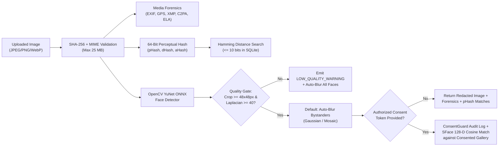

# 07 — VISUAL INTELLIGENCE SPECIFICATION (`M11`)

**Target Repository:** [`https://github.com/Manan7289/OSINT.git`](https://github.com/Manan7289/OSINT.git)  
**Target Files:** `backend/visual/vision_engine.py`, `backend/visual/media_forensics.py`, `backend/visual/consent_guard.py`, `frontend/assets/visual_studio.js`  
**Core Mandate:** Privacy-Preserving Visual Intelligence, Image Quality Assessment, Perceptual Deduplication, Forensic Metadata Extraction, and Consent-Gated Identity Verification

---

## 1. Purpose & Strict Ethical Boundaries

The user explicitly requested a dedicated **Visual Intelligence & Media Forensics Workspace** capable of analyzing uploaded images and OSINT media assets while enforcing uncompromising privacy and ethical safeguards:
- **ALLOWED & MANDATORY:**
  1. **Image Upload & Forensic Inspection:** Local drag-and-drop analysis of JPEG, PNG, WebP, and TIFF images.
  2. **EXIF / GPS / XMP / C2PA Metadata Extraction:** Extracting camera make/model, timestamps, GPS coordinates (auto-plotting on the 2D/3D globe), software tags, and Content Authenticity Initiative (C2PA/JUMBF) manifest signatures.
  3. **64-Bit Perceptual Hashing (`pHash`, `dHash`, `aHash`):** Detecting near-duplicate, cropped, recompressed, or watermarked images across collected OSINT documents using Hamming distance ($\le 10$ bits).
  4. **Face Detection & Image Quality Gate (`OpenCV YuNet` + Laplacian Variance):** Detecting faces in an image, computing bounding boxes, 5-point landmarks, confidence scores, and per-face resolution/sharpness quality metrics.
  5. **Automatic Bystander Face Blurring (Default ON):** Automatically blurring all detected faces (or all non-target bystander faces) using Gaussian/pixelation redaction before saving or exporting any intelligence report.
  6. **Consent-Gated 1:1 / 1:N Authorized Gallery Verification (`OpenCV SFace`):** Comparing a detected face embedding **exclusively** against a locally enrolled `consented_face_gallery` where each entry has an explicit signed consent record (`consent_token`, `subject_name`, `purpose`, `expires_at`).
- **STRICTLY PROHIBITED (Architectural Hard Blocks):**
  1. **No Unrestricted Stranger Identification:** The system has **no integration** with Clearview AI, PimEyes, FindClone, or scraped social-media face databases.
  2. **No Covert Live CCTV Biometric Tracking:** Live public traffic/weather cameras (`M03`) cannot be piped into continuous automated facial recognition loops.
  3. **No Low-Quality False-Positive Matching:** If a detected face crop is smaller than `48x48` pixels or has a Laplacian sharpness variance $< 40.0$, the engine refuses biometric embedding extraction and displays an explicit `LOW_QUALITY_IMAGE_WARNING`.

---

## 2. Visual Intelligence Pipeline Architecture

---

## 3. Mathematical & Algorithmic Specifications

### 3.1 Perceptual Hashing (`backend/visual/media_forensics.py`)
For every ingested image $I$:
1. Convert $I$ to grayscale and resize to $32 	imes 32$ using bicubic interpolation.
2. Compute the 2D Discrete Cosine Transform (DCT-II):
   $$F(u, v) = c(u)c(v) \sum_{x=0}^{31}\sum_{y=0}^{31} I(x,y) \cos\left[rac{(2x+1)u\pi}{64}
ight] \cos\left[rac{(2y+1)v\pi}{64}
ight]$$
3. Extract the top-left $8 	imes 8$ low-frequency submatrix $F_{8	imes 8}$ (excluding the DC component $F(0,0)$) and compute the median $	ilde{m} = 	ext{median}(F_{8	imes 8})$.
4. Construct the 64-bit integer hash:
   $$H_i = egin{cases} 1 & 	ext{if } F_i > 	ilde{m} \ 0 & 	ext{otherwise} \end{cases}$$
5. **Similarity Metric:** Given two 64-bit hashes $H_A, H_B$, the Hamming distance is:
   $$d_H(H_A, H_B) = 	ext{popcount}(H_A \oplus H_B)$$
   Normalized similarity is $S_{	ext{pHash}} = 1 - rac{d_H(H_A, H_B)}{64.0}$. Images with $d_H \le 10$ ($S_{	ext{pHash}} \ge 0.84375$) are linked via a `VISUALLY_SIMILAR_TO` edge in the knowledge graph.

### 3.2 Image Quality & Blur Detection (`backend/visual/vision_engine.py`)
To prevent misleading visual analysis on degraded or pixelated thumbnails:
1. Compute the discrete 2D Laplacian operator $\Delta I$ on the grayscale image (and on each detected face bounding box):
   $$L = egin{bmatrix} 0 & 1 & 0 \ 1 & -4 & 1 \ 0 & 1 & 0 \end{bmatrix} * I$$
2. Compute the variance of the Laplacian:
   $$\sigma_L^2 = 	ext{Var}(L) = rac{1}{N}\sum_{x,y} \left(L(x,y) - \mu_L
ight)^2$$
3. **Quality Classification Thresholds:**
   - $\sigma_L^2 < 40.0$ or face bounding box $\min(w, h) < 48	ext{ px}$: **`POOR_BLURRY`** — Biometric matching is blocked (`verification_allowed = False`), and the UI displays an amber/red quality banner explaining that low pixel density or motion blur prevents reliable feature extraction.
   - $40.0 \le \sigma_L^2 < 120.0$ and $\min(w, h) \ge 48	ext{ px}$: **`MODERATE`** — Allowed with confidence penalty.
   - $\sigma_L^2 \ge 120.0$ and $\min(w, h) \ge 80	ext{ px}$: **`HIGH_SHARPNESS`**.

### 3.3 Face Detection & Bystander Redaction (`OpenCV YuNet`)
- **Model:** `face_detection_yunet_2023mar.onnx` (337 KB, Apache-2.0, bundled in `data/models/`).
- **Execution:** `cv2.FaceDetectorYN.create(model_path, "", (width, height), score_threshold=0.75, nms_threshold=0.3, top_k=500)`.
- **Fallback When Model File Is Absent:** If the ONNX file is missing in an offline environment prior to running `install.bat`, gracefully fall back to OpenCV's built-in `cv2.CascadeClassifier(cv2.data.haarcascades + 'haarcascade_frontalface_default.xml')` while surfacing `detector_mode="HAAR_FALLBACK"` so face detection and bystander blurring **always work** with zero external downloads.
- **Automatic Bystander Blurring:**
  - By default (`blur_bystanders=True`), every detected face ROI $R = [x, y, w, h]$ is redacted using an adaptive Gaussian kernel $k = 2 \lfloor \max(w, h)/6 
floor + 1$ followed by $8	imes 8$ block pixelation so the blurred region cannot be reversed via deconvolution.

### 3.4 Consent-Gated Identity Verification (`OpenCV SFace` + `ConsentGuard`)
- **Model:** `face_recognition_sface_2021dec.onnx` (36.9 MB, Apache-2.0, bundled/downloaded via `install.bat`).
- **Strict Consent Enforcement (`backend/visual/consent_guard.py`):**
  1. Enrolling a reference face into `consented_face_gallery` requires:
     - `subject_name` (non-empty string)
     - `consent_attestation` (boolean, must be `True`)
     - `consent_purpose` (e.g., `"Authorized OSINT PoC / Executive Protection / Missing Person Case #104"`)
     - `expires_at` (ISO-8601 timestamp, max 90 days)
  2. Running `/api/v1/visual/verify` requires passing an active `consent_reason` and logs an immutable SHA-256 chained audit record (`ACTION="CONSENT_GATED_FACE_VERIFY"`) in the `audit_log` table.
  3. Cosine similarity between 128-D L2-normalized `SFace` embeddings $\mathbf{u}, \mathbf{v}$:
     $$\cos(	heta) = rac{\mathbf{u} \cdot \mathbf{v}}{\|\mathbf{u}\|_2 \|\mathbf{v}\|_2}$$
     A match is reported only if $\cos(	heta) \ge 0.363$ (the official OpenCV SFace FAR $10^{-3}$ threshold) **and** the face passed the Quality Gate ($\sigma_L^2 \ge 40.0$, $\min(w,h) \ge 48	ext{ px}$).

---

## 4. REST API Endpoints for Visual Intelligence (`M11`)

| Method | Endpoint | Description |
| :--- | :--- | :--- |
| `POST` | `/api/v1/visual/analyze` | Accepts multipart image upload (or base64 JSON) + `blur_bystanders: bool = True`. Extracts EXIF/GPS/C2PA, computes `pHash`/`dHash`/`aHash`, queries SQLite for visually similar assets ($d_H \le 10$), detects faces via YuNet, computes Laplacian quality scores, returns base64 redacted image + forensic report, and auto-creates a `VISUAL_ASSET` entity (and `LOCATION` edge if EXIF GPS exists). |
| `POST` | `/api/v1/visual/gallery/enroll` | Enrolls an authorized reference image into `consented_face_gallery` after verifying `consent_attestation == True` and passing the Laplacian/resolution quality gate. |
| `POST` | `/api/v1/visual/verify` | Performs consent-gated 1:N cosine verification of high-quality detected faces against non-expired entries in `consented_face_gallery`, logging the operation to the tamper-evident SHA-256 audit chain. |
| `GET` | `/api/v1/visual/assets` | Lists analyzed visual assets with their perceptual hashes, EXIF GPS coordinates, quality scores, and duplicate cluster IDs. |
