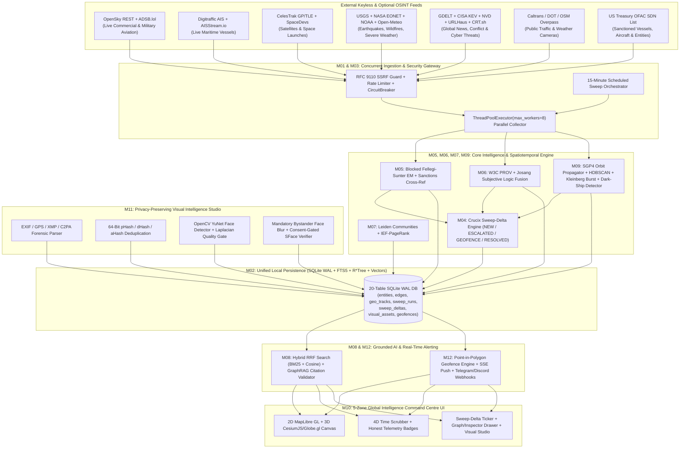
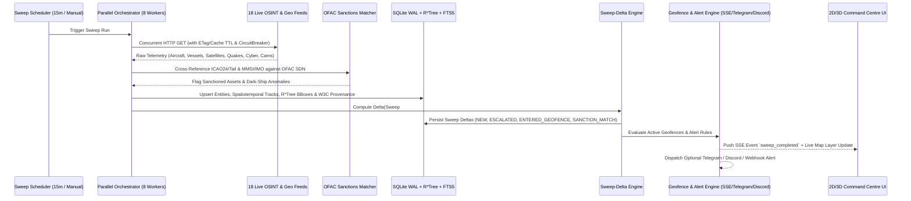

# 05 — SYSTEM ARCHITECTURE (`LocalOSINT v3.0`)

**Target Repository:** [`https://github.com/Manan7289/OSINT.git`](https://github.com/Manan7289/OSINT.git)  
**Architecture Paradigm:** Zero-Docker Single-Command Local-First Python 3.11+ Monolith with Concurrent Sweep Scheduler, Spatiotemporal SQLite Engine, Privacy-Preserving Visual Intelligence Studio, and 2D/3D Geospatial Command Centre

---

## 1. Architectural Overview & Core Principles

`LocalOSINT v3.0` upgrades the existing `Manan7289/OSINT` foundation into a unified **Next-Generation Global Intelligence Command Centre** that integrates:
1. **Argos Atlas (`argosatlas.com` / `argos.foundation`):** Live aviation & maritime tracking with automated **OFAC SDN sanctions cross-referencing**, GPS/GNSS interference heatmaps, geolocated conflict/disaster events, and multi-agency public camera feeds.
2. **Crucix (`github.com/calesthio/Crucix`):** Automated 15-minute scheduled parallel OSINT sweeps, **Sweep-Delta Analysis** (`NEW_ENTITY`, `ESCALATED_RISK`, `ENTERED_GEOFENCE`, `SANCTION_MATCH_DETECTED`, `RESOLVED_EVENT`), SSE real-time push, and Telegram/Discord/Webhook alerting.
3. **God's Eye View (`github.com/bilawalsidhu/gods-eye-view`):** Keyless-first 2D/3D globe (`MapLibre GL JS` + `CesiumJS`/`Globe.gl`), real-time `SGP4` satellite orbital propagation (`CelesTrak`), 4D historical time-scrubber playback, and transparent telemetry status badges (`LIVE`, `DELAYED`, `ORBITAL_PROPAGATED`, `HISTORICAL`, `OFFLINE_BOOTSTRAP`).
4. **Privacy-Preserving Visual Intelligence (`backend/visual/`):** Local CPU-executable `OpenCV YuNet` face detection, automatic bystander face blurring, Laplacian image quality scoring, 64-bit `pHash`/`dHash` visual deduplication, EXIF/XMP/C2PA metadata extraction, and **strictly consent-gated** `SFace`/`ArcFace` face verification.

---

## 2. Target Repository Directory Structure (`Manan7289/OSINT`)

Antigravity must evolve the repository cleanly to match this exact target layout:

```text
OSINT/
├── start.bat                              # Windows 11 1-click launcher (auto-checks venv, models, starts server)
├── install.bat                            # Windows 11 dependency + ONNX vision model bootstrapper
├── requirements.txt                       # Python 3.11+ dependencies (FastAPI, scipy, igraph, leidenalg, hdbscan, sgp4, opencv-python-headless, Pillow, imagehash)
├── .env.example                           # Optional API keys (AISStream, NASA FIRMS, Cesium ion, Telegram, Discord, Ollama)
├── README.md                              # Comprehensive v3.0 architecture, launch, and verification guide
├── backend/
│   ├── main.py                            # FastAPI v3.0 server (REST + SSE /api/v1/stream + /api/v1/geospatial/* + /api/v1/visual/* + /api/v1/sweeps/*)
│   ├── core/
│   │   ├── config.py                      # Paths, rate-limit budgets, sweep intervals, hardware capability detector
│   │   ├── security.py                    # DPAPI/Fernet Vault, RFC 9110 SSRF guard, Thread-Safe CircuitBreaker, SHA-256 Audit Chain
│   │   ├── database.py                    # 20-table SQLite WAL + FTS5 + R*Tree schema & CRUD methods
│   │   ├── ontology.py                    # Pydantic v2 models for 14 Entity Types, 18 Edge Types, Geospatial Tracks, Visual Assets, Sweeps
│   │   ├── entity_resolution.py           # 3-Pass Blocked Fellegi-Sunter EM with Beta(1,1) smoothing & Jaro-Winkler/Soundex
│   │   ├── provenance_fusion.py           # W3C PROV-DM + Josang Subjective Logic cumulative/averaging fusion + NATO Admiralty
│   │   ├── graph_analytics.py             # Leiden community detection + IEF-weighted PageRank + structural anomaly detection
│   │   └── spatiotemporal.py              # Haversine great-circle math, HDBSCAN spatial clustering, Kleinberg burst, Co-Traveler convoy detection
│   ├── collectors/
│   │   ├── base.py                        # Abstract BaseCollector with cache TTL, rate limiter, CircuitBreaker, provenance builder
│   │   ├── orchestrator.py                # ThreadPoolExecutor(max_workers=8) parallel orchestrator + 15-min Scheduled Sweep loop
│   │   ├── sweep_delta.py                 # Crucix-style Sweep-Delta Engine (compares Sweep N vs Sweep N-1, computes escalations)
│   │   ├── cyber_osint_adapters.py        # Existing 12 cyber/identity adapters (CISA KEV, NVD, CRT.sh, URLHaus, GitHub, ArXiv, Nominatim, etc.)
│   │   ├── aviation_adapter.py            # Live OpenSky Network REST + ADSB.lol military/global fallback + OFAC tail/ICAO24 cross-ref
│   │   ├── maritime_adapter.py            # Live Digitraffic AIS REST + AISStream.io WebSocket + OFAC MMSI/IMO cross-ref + dark-ship detector
│   │   ├── satellite_adapter.py           # Live CelesTrak GP/TLE JSON + sgp4 Python real-time propagation + ground-track footprint
│   │   ├── natural_events_adapter.py      # Live USGS Earthquakes GeoJSON + NASA EONET v3 + NOAA NWS CAP Weather Alerts + Open-Meteo
│   │   ├── conflict_news_adapter.py       # Live GDELT GeoJSON v2 + ReliefWeb Disasters + Curated Geo-RSS Feeds
│   │   ├── camera_adapter.py              # Live Caltrans CCTV + TxDOT + 511 DOT + OpenStreetMap surveillance camera aggregator
│   │   └── sanctions_loader.py            # Live/Cached US Treasury OFAC SDN parser (extracts vessel MMSI/IMO & aircraft tail numbers)
│   ├── visual/
│   │   ├── __init__.py
│   │   ├── vision_engine.py               # OpenCV YuNet face detection, SFace embedding, Laplacian sharpness, bystander auto-blur
│   │   ├── media_forensics.py             # EXIF/GPS/XMP/C2PA parser + 64-bit pHash/dHash/aHash computation & Hamming index
│   │   └── consent_guard.py               # Enforces mandatory consent attestation & audit logging before any face gallery comparison
│   ├── alerts/
│   │   ├── __init__.py
│   │   └── alert_engine.py                # Point-in-polygon geofence evaluator + Telegram Bot, Discord Webhook, and SSE dispatcher
│   └── ai/
│       ├── search_rrf.py                  # Hybrid FTS5 BM25 + Vector Cosine Reciprocal Rank Fusion (k=60)
│       └── assistant.py                   # GraphRAG grounded investigator + Sweep-Delta Executive Briefing generator + Citation Validator
├── frontend/
│   ├── index.html                         # Full-viewport 5-Zone Global Intelligence Command Centre shell
│   └── assets/
│       ├── styles.css                     # Tactical Command-Centre dark HUD CSS (glassmorphic panels, telemetry badges, timeline)
│       ├── app.js                         # Main controller, SSE client, keyboard shortcuts, workspace state manager
│       ├── globe_map.js                   # Dual 2D MapLibre GL JS + 3D CesiumJS/Globe.gl synchronizer, SGP4 tick loop, layer manager
│       ├── timeline_4d.js                 # 4D Historical Time Scrubber, playback speed controller (1x–60x), event density sparkline
│       ├── sweep_delta_hud.js             # Crucix-style Sweep-Delta drawer, escalation feed, and geofence drawing tools
│       └── visual_studio.js               # Privacy-Preserving Visual Intelligence workspace (upload, EXIF, pHash, auto-blur, consent gate)
├── data/
│   ├── bootstrap/                         # Offline fallback datasets (sample OFAC SDN subset, TLEs, cameras, geo events) for air-gapped demo
│   └── models/                            # OpenCV Zoo ONNX models (`face_detection_yunet_2023mar.onnx`, `face_recognition_sface_2021dec.onnx`)
└── tests/
    ├── test_api_smoke.py                  # End-to-end FastAPI test suite (existing + new v3.0 endpoints)
    ├── test_geospatial_and_sweeps.py      # Tests SGP4 propagation, OFAC vessel/aircraft cross-ref, R*Tree bbox, and Sweep-Delta engine
    └── test_visual_privacy.py             # Tests YuNet detection, mandatory bystander blur, pHash Hamming search, and consent guard
```

---

## 3. System Component Architecture Diagram



---

## 4. End-to-End Data Flow & Sweep-Delta Lifecycle



---

## 5. Retaining & Enhancing Existing Repository Modules vs. New Modules

| Module ID | Existing File(s) in `Manan7289/OSINT` | Action Required in v3.0 |
| :--- | :--- | :--- |
| **M01** | `backend/core/config.py`, `backend/core/security.py` | **Retain & Fix:** Fix `threading.Lock()` in `CircuitBreaker`; add rate-limit budgets and URL allowlists for new aviation/maritime/satellite/weather APIs. |
| **M02** | `backend/core/database.py`, `backend/core/ontology.py` | **Retain & Expand:** Keep existing 14 tables; add 6 new tables (`geo_tracks`, `sweep_runs`, `sweep_deltas`, `geofence_zones`, `visual_assets`, `consented_face_gallery`). |
| **M03** | `backend/collectors/orchestrator.py` | **Refactor & Parallelize:** Replace sequential `for` loop with `ThreadPoolExecutor(max_workers=8)`; add background 15-minute scheduled sweep daemon; integrate 6 new geospatial collector modules. |
| **M04** | `backend/collectors/sweep_delta.py` *(New)* | **Create New:** Implement Crucix-inspired Sweep-Delta Engine comparing consecutive sweeps and generating structured delta records. |
| **M05** | `backend/core/entity_resolution.py` | **Retain & Fix:** Apply `Beta(1,1)` Laplace smoothing to Fellegi-Sunter EM loop; add deterministic cross-matching of aircraft `icao24`/tail and vessel `mmsi`/`imo` against OFAC sanctions. |
| **M06** | `backend/core/provenance_fusion.py` | **Retain:** Keep Josang Subjective Logic cumulative/averaging fusion and NATO Admiralty ratings; apply to all new geospatial and visual claims. |
| **M07** | `backend/core/graph_analytics.py` | **Retain:** Keep Leiden (`leidenalg`), IEF-weighted PageRank, and Ego-Network extraction; connect map assets directly to graph nodes. |
| **M08** | `backend/ai/search_rrf.py`, `backend/ai/assistant.py` | **Retain & Upgrade:** Fix `valid_ratio` check in `assistant.py`; add automated **Sweep-Delta Intelligence Briefing** generation. |
| **M09** | `backend/core/spatiotemporal.py` | **Retain & Expand:** Keep HDBSCAN and Kleinberg burst; add `sgp4` satellite propagation, vessel dark-ship gap detection, and GPS jamming heatmap grid aggregation. |
| **M10** | `frontend/index.html`, `frontend/assets/*` | **Redesign:** Replace basic 4-tab layout with the **5-Zone Full-Viewport 2D/3D Global Command Centre** while preserving Graph, Timeline, Search, and Audit capabilities inside interactive drawers. |
| **M11** | `backend/visual/*` *(New)* | **Create New:** Implement Privacy-Preserving Visual Intelligence Studio (`YuNet`, `SFace`, `pHash`, EXIF/C2PA, auto-blur, consent gate). |
| **M12** | `backend/alerts/alert_engine.py` *(New)* | **Create New:** Implement Point-in-Polygon geofence evaluator, SSE `/api/v1/stream` push endpoint, and Telegram/Discord webhook dispatchers. |
