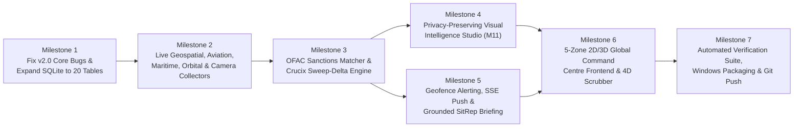

# 11 — IMPLEMENTATION ROADMAP (`LocalOSINT v3.0`)

**Target Repository:** [`https://github.com/Manan7289/OSINT.git`](https://github.com/Manan7289/OSINT.git)  
**Target Implementing Agent:** Antigravity (Gemini 3.8 Flash)  
**Execution Strategy:** 7-Milestone Dependency-Ordered Engineering Plan (Retaining & Fixing v2.0 Core + Building v3.0 Global Geospatial, Sweep-Delta, and Visual Intelligence Capabilities)

---

## 1. Milestone Overview & Dependency Graph

---

## 2. Step-by-Step Milestones for Antigravity

### Milestone 1 — Core Hardening & 20-Table SQLite Schema Expansion (`M01`, `M02`, `M05`, `M08`)
- **Files to Modify:**
  - `backend/core/security.py`: Add `self._lock = threading.Lock()` inside `CircuitBreaker` and wrap `allow_request()`, `record_success()`, and `record_failure()` with `with self._lock:`.
  - `backend/core/entity_resolution.py`: Apply `Beta(1, 1)` Laplace smoothing (`(1.0 + sum_g_gamma) / (2.0 + sum_g)`) inside `FellegiSunterResolver.fit_em()` so $m_k$ and $u_k$ never collapse on small batches.
  - `backend/ai/assistant.py`: Fix `validate_citations()` so `is_valid = (valid_ratio == 1.0 and len(stripped_sentences) == 0)`.
  - `backend/core/ontology.py`: Add `AIRCRAFT`, `VESSEL`, `SATELLITE`, `CAMERA`, and `VISUAL_ASSET` to `EntityType`; add `SANCTIONED_UNDER`, `PROXIMATE_TO_EVENT`, `POTENTIAL_STS_TRANSFER`, `ENTERED_GEOFENCE`, `VISUALLY_SIMILAR_TO`, and `CAPTURED_NEAR` to `EdgeType`; define Pydantic models for `GeoTrackPoint`, `SweepRun`, `SweepDelta`, `GeofenceZone`, and `VisualAnalysisReport`.
  - `backend/core/database.py`: Add the 6 new tables (`geo_tracks`, `sweep_runs`, `sweep_deltas`, `sanctions_index`, `geofence_zones`, `visual_assets`, `consented_face_gallery`) and their CRUD/query methods while preserving all 14 existing tables.
- **Verification Gate 1:** Run `pytest tests/test_api_smoke.py` — all 20 tables initialize cleanly in WAL mode with zero errors.

### Milestone 2 — Live Geospatial, Aviation, Maritime, Satellite, Hazard & Camera Collectors (`M03`, `M09`)
- **Files to Create / Modify:**
  - `backend/collectors/sanctions_loader.py`: Parses US Treasury OFAC SDN entries (live CSV + `data/bootstrap/ofac_sdn_sample.json` fallback) into `sanctions_index`, indexing `mmsi`, `imo`, `icao24`, `tail_number`, and normalized names.
  - `backend/collectors/aviation_adapter.py`: Polls OpenSky Network REST (`/api/states/all`) and ADSB.lol (`/v2/mil`), normalizes into `AIRCRAFT` entities + `geo_tracks`, flags emergency squawks (`7500`, `7600`, `7700`), detects GPS interference (`NACp <= 4`), and cross-references `sanctions_index`.
  - `backend/collectors/maritime_adapter.py`: Polls Digitraffic Marine AIS (`/api/ais/v1/locations`) + optional `AISStream.io` WebSocket + `data/bootstrap/maritime_bootstrap.json` fallback (explicitly tagged `OFFLINE_BOOTSTRAP`), cross-references `sanctions_index`, and runs AIS dark-ship gap detection.
  - `backend/collectors/satellite_adapter.py`: Fetches CelesTrak GP/TLE JSON (`GROUP=active`/`stations`/`military`) with local TLE bootstrap fallback, and uses `sgp4` (`sgp4.api.Satrec`) to compute real-time WGS84 `(lat, lon, alt_km, velocity_kms)`, footprint radius, and 90-minute ground track.
  - `backend/collectors/natural_events_adapter.py`: Fetches USGS Earthquakes GeoJSON (`2.5_day.geojson`), NASA EONET v3 open events, NOAA NWS active weather alerts, and Open-Meteo local telemetry.
  - `backend/collectors/camera_adapter.py`: Aggregates Caltrans/DOT live CCTV JSON feeds and OpenStreetMap `man_made=surveillance` nodes + `data/bootstrap/public_cameras.json`.
  - `backend/collectors/orchestrator.py`: Upgrade `run_collection()` to execute adapters concurrently via `ThreadPoolExecutor(max_workers=8)`.
- **Verification Gate 2:** Call `/api/v1/geospatial/layers` and verify non-empty GeoJSON FeatureCollections for `AIRCRAFT`, `VESSEL`, `SATELLITE`, `EARTHQUAKE`, `WILDFIRE`, `WEATHER`, and `CAMERA` with explicit `telemetry_status` badges.

### Milestone 3 — Crucix-Style Sweep-Delta Engine & Scheduled Sweeps (`M04`)
- **Files to Create / Modify:**
  - `backend/collectors/sweep_delta.py`: Implements `SweepDeltaEngine.compute_sweep_deltas(sweep_id, prev_sweep_id)` classifying `NEW_ENTITY`, `SANCTION_MATCH_DETECTED`, `ESCALATED_RISK`, `ENTERED_GEOFENCE`, `AIS_DARK_GAP`, and `RESOLVED_EVENT`, and calculating the composite Global Escalation Score $E_{	ext{sweep}} \in [0, 100]$.
  - `backend/main.py`: Add background scheduled sweep loop (configurable interval, default 15 minutes, plus manual trigger `POST /api/v1/sweeps/run`), `GET /api/v1/sweeps/latest`, and `GET /api/v1/sweeps/{sweep_id}/deltas`.
- **Verification Gate 3:** Trigger two consecutive sweeps (`POST /api/v1/sweeps/run`) and verify that `sweep_runs` and `sweep_deltas` accurately record newly appeared entities, sanctions matches, and risk escalations.

### Milestone 4 — Privacy-Preserving Visual Intelligence Studio (`M11`)
- **Files to Create:**
  - `backend/visual/media_forensics.py`: Extracts EXIF/GPS/XMP/C2PA metadata via `Pillow` and computes 64-bit `pHash`, `dHash`, and `aHash` with Hamming distance lookup ($d_H \le 10$) against `visual_assets`.
  - `backend/visual/vision_engine.py`: Runs `OpenCV YuNet` (`cv2.FaceDetectorYN` with automatic `haarcascade_frontalface_default.xml` fallback if ONNX weights are not yet downloaded), computes Laplacian sharpness variance $\sigma_L^2$, enforces the Quality Gate ($\sigma_L^2 \ge 40.0$, crop $\ge 48	imes 48	ext{ px}$), and applies automatic Gaussian + mosaic bystander face blurring (`blur_bystanders=True` by default).
  - `backend/visual/consent_guard.py`: Enforces explicit consent attestation, non-expired gallery validation, and SHA-256 audit logging before running `SFace` 128-D cosine verification.
- **Verification Gate 4:** Run `pytest tests/test_visual_privacy.py` — verify EXIF/pHash extraction, automatic face blurring, low-quality rejection, and hard rejection of unconsented verification calls.

### Milestone 5 — Geofence Alerting, SSE Push & Grounded SitRep Briefing (`M08`, `M12`)
- **Files to Create / Modify:**
  - `backend/alerts/alert_engine.py`: Implements Ray-Casting Point-in-Polygon geofence evaluation, manages SSE subscriber queues for `GET /api/v1/stream`, and dispatches optional Telegram Bot / Discord Webhook notifications.
  - `backend/ai/assistant.py`: Adds `generate_sweep_briefing(sweep_id)` producing a fully cited (`[PROV:...]` / `[DELTA:...]`) Markdown SitRep.
- **Verification Gate 5:** Create a geofence polygon around a tracked vessel/aircraft coordinate, run a sweep, and verify an `ENTERED_GEOFENCE` delta and SSE event are emitted.

### Milestone 6 — 5-Zone 2D/3D Global Command Centre Frontend (`M10`)
- **Files to Create / Modify:**
  - `frontend/index.html`, `frontend/assets/styles.css`, `frontend/assets/app.js`, `frontend/assets/globe_map.js`, `frontend/assets/timeline_4d.js`, `frontend/assets/sweep_delta_hud.js`, `frontend/assets/visual_studio.js`.
  - Implement seamless 2D (`MapLibre GL JS`) and 3D (`Globe.gl` / `CesiumJS`) synchronized canvas, layer toggles with live telemetry badges, Region Preset fly-to buttons, 4D Time Scrubber (`LIVE` vs `HISTORICAL` replay), Crucix Sweep-Delta drawer, Geofence polygon drawing tool, PiP Camera / Visual Intelligence Studio drawer, and Cytoscape Ego-Graph + Subjective Logic inspector.
- **Verification Gate 6:** Open `http://127.0.0.1:8420` in browser and verify every button, layer toggle, 2D/3D switch, time scrubber, visual upload, and graph inspector works end-to-end with zero dead controls.

### Milestone 7 — Full Verification Suite, Windows Scripts & Repository Push
- **Files to Update:** `requirements.txt`, `install.bat`, `start.bat`, `README.md`, `tests/test_api_smoke.py`, `tests/test_geospatial_and_sweeps.py`, `tests/test_visual_privacy.py`.
- **Verification Gate 7:** Execute `pytest -v` (100% pass rate), verify `git status` is clean, commit, and push to `https://github.com/Manan7289/OSINT.git`.
